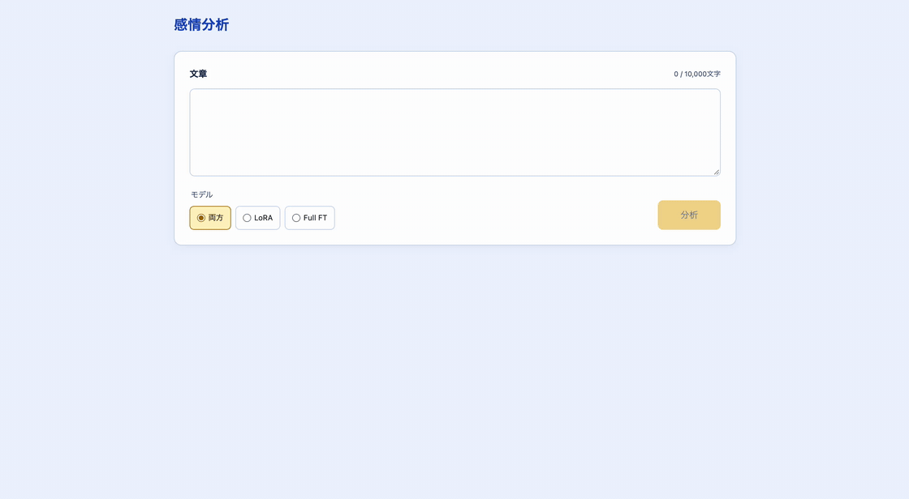
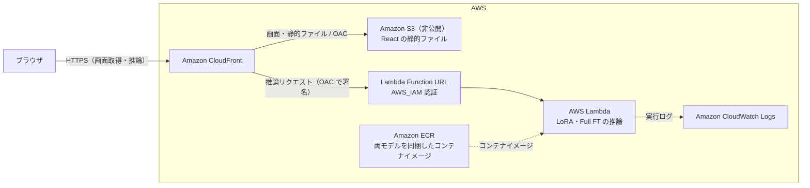

# WRIME Sentiment Demo

日本語の文章を5段階の感情極性に分類するWebアプリ。
[WRIME Ver.2](https://github.com/ids-cv/wrime)を使い、[Gemma 3 270M](https://huggingface.co/google/gemma-3-270m)を感情極性分類向けにLoRAとFull FTでそれぞれチューニングした2つのモデルの推論結果を比較する。

## デモ



## 起動

LoRAとFull FTの学習済みモデルは、容量が大きいためGitHubリポジトリに含めておらず、別途配布もしていません。リポジトリをクローンしただけではローカルで推論できません。以下の起動手順は、推論用モデルを手元に持っている場合に利用できます。

Python 3.12、[uv](https://docs.astral.sh/uv/)、Node.js 22.12以降が必要。コマンドはリポジトリのルートで実行する。

### 初回セットアップ

Pythonとフロントエンドの依存関係をインストールする。

```bash
make setup
npm --prefix src/frontend i
```

### ローカルで起動

2つのターミナルでそれぞれ実行する。

```bash
# ターミナル1: 推論API
make api
# ターミナル2: 画面
make frontend
```

## ファイル構成

```text
src/
  backend/   FastAPI・モデルの推論処理
  frontend/  Reactの画面・Vite設定
  infra/     TypeScriptのCDK定義・Lambda用コンテナ・実行手順
  models/    LoRA・Full FTの推論用モデル（Git管理外）
scripts/     モデル準備
```

## インフラ構成


