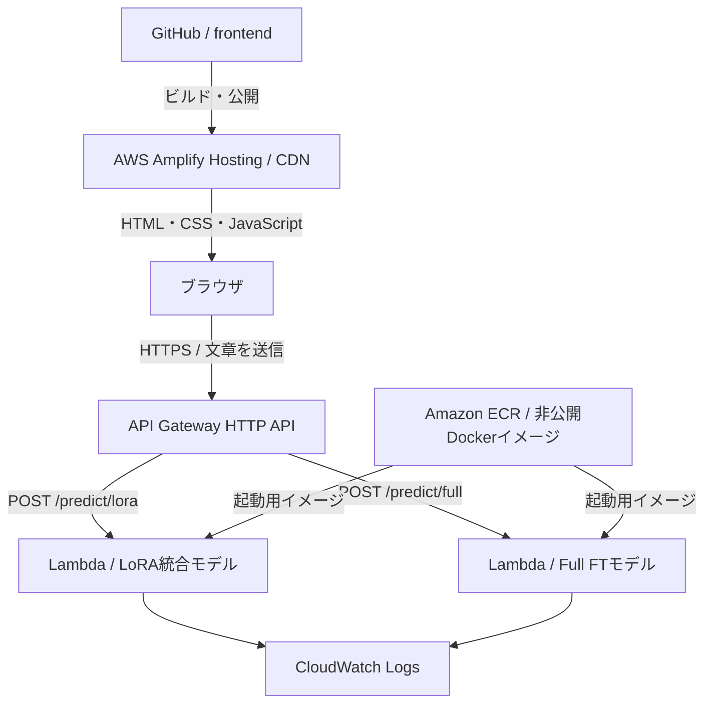

# WRIME Sentiment Demo

WRIME Ver.2で追加学習したGemma 3 270Mを使い、日本語SNS投稿の感情極性を5クラスに分類するWebアプリ。
LoRAとフルファインチューニング（Full FT）の予測を画面から確認・比較する。

## 現在の状態

構成検討段階。現時点ではREADMEのみで、フロントエンド・推論API・AWSインフラは未実装・未デプロイ。
学習済みモデルは別途用意し、この公開リポジトリには含めない。

## AWS構成（予定）



| サービス | 役割 |
| --- | --- |
| AWS Amplify Hosting | React + Viteの静的フロントエンドをビルドし、CDN・HTTPSで配信する |
| API Gateway HTTP API | ブラウザからの推論リクエストをLambdaに渡す |
| AWS Lambda | CPUで感情分析を行う。LoRAとFull FTを別々の関数として配置する |
| Amazon ECR | Python・CPU版PyTorch・依存ライブラリ・重み・tokenizerを含むイメージを非公開で保存する |
| Amazon CloudWatch Logs | エラーや処理時間を確認する。入力文章は標準では記録しない |
| AWS IAM | デプロイ・実行に必要な権限を管理する |

東京リージョンを想定する。CDNはグローバルに配信される。
初期構成ではALB、常駐サーバー、データベース、独自ドメインは用意しない。
ブラウザからAWSのアクセスキーを利用せず、APIの認証方式は実装時に決定する。
CORSはフロントエンドの公開オリジンに合わせて設定する。CORS自体は認証の代わりにはならない。

## モデルと推論

- 基盤モデル: `google/gemma-3-270m`
- 学習データ: `shunk031/wrime` の `ver2`
- 正解ラベル: `writer.sentiment`
- 感情極性: `-2, -1, 0, +1, +2`
- クラスID: `0, 1, 2, 3, 4`。APIでは元の感情極性へ戻す。
- 入力上限: 特殊トークンを含めて512トークン。切り詰めが発生した場合は応答に含める。

LoRAは保存済みアダプタ（学習済み分類ヘッドを含む）を元のGemmaに読み込み、
`merge_and_unload()` で統合したモデルを作って配置する。
アダプタ単体では推論できない。統合前後の予測を検証する。
Full FTは保存済みの最良モデルを使用する。両者ともモデルと対応するtokenizerを配置する。

それぞれのLambdaは1モデルだけを読み込む。モデルはハンドラーの外で初期化し、
実行環境が再利用された場合にはメモリ上のモデルを使い回す。
`model.eval()` と `torch.inference_mode()` を使い、推論時に学習・勾配計算は行わない。
最後の非パディングトークン位置の分類スコアから投稿全体の感情を予測する。

## 画面（予定）

- 投稿文の入力欄
- LoRA / Full FT / 両方のモデル選択
- 分析ボタンと処理中の表示
- 感情極性、5クラスの予測確率、処理時間の表示
- 両モデルの結果比較
- 入力エラー、切り詰め、タイムアウトの表示

予測確率は分類スコアにsoftmaxを適用した値であり、正答率を保証する値ではない。

## API（予定）

- `POST /predict/lora`
- `POST /predict/full`

リクエスト例:

```json
{
  "text": "今日はとても楽しかった！"
}
```

応答例（数値は説明用）:

```json
{
  "model": "lora",
  "model_version": "v1",
  "sentiment": 2,
  "probabilities": {
    "-2": 0.01,
    "-1": 0.02,
    "0": 0.07,
    "1": 0.25,
    "2": 0.65
  },
  "truncated": false
}
```

「両方」を選んだ場合は、フロントエンドから2つのAPIを呼び出す。
APIのURLをフロントエンドの設定に渡す。秘密情報はフロントエンドへ埋め込まない。

## 実装・検証の進め方

1. ローカルでLoRA統合モデルとFull FTモデルの推論を確認する。
2. 推論処理をLambda用コンテナにまとめる。ライブラリとモデルの版を固定する。
3. フロントエンドを作り、ローカルでAPIとの接続を確認する。
4. AWS CloudFormationのYAMLテンプレートでAWS構成を定義し、スタック単位で作成・更新・削除できるようにする。DockerイメージのビルドとECRへのpushは別途実行し、イメージURIをテンプレートに渡す。
5. AWS上で初回・実行環境再利用時・長い入力・同時アクセス時の応答時間とメモリを測る。
6. ブラウザから両モデルの予測を確認したら、AWSリソースを削除する。

Lambdaの初期検証は各関数メモリ4GB・CPU推論を想定し、測定結果に応じて調整する。
API Gateway HTTP APIの統合タイムアウトは最大30秒のため、コールドスタートを含めて検証する。
応答が間に合わない場合は、初期化の改善や非同期APIなど構成変更を検討する。

## ディレクトリ構成（予定）

```text
frontend/   # React + Vite
backend/    # Lambdaハンドラー・推論処理・Dockerfile
infra/      # AWS CloudFormationのYAMLテンプレート
```

## 利用期間・費用・削除

卒論の動作確認用に短期間公開し、確認後は閉じる運用を想定する。
既存のAWSアカウントを利用するため、新規登録向けクレジットや期間限定無料枠は前提にしない。
Lambdaの無料枠に収まる可能性はあるが、Amplify・API Gateway・ECR・ログ等を含めた0円は保証しない。
とくにモデル入りコンテナイメージは大きく、ECRの保存料金に注意する。

終了時はインフラの削除に加え、以下の残存リソースを確認する。

- Amplifyアプリと公開ブランチ
- API Gateway、Lambda、関連IAMロール
- ECRイメージ・リポジトリ
- CloudWatchのロググループ
- デプロイ用に作成したS3オブジェクト・バケット（使用した場合。必要なものは保持）

画面やブラウザを閉じるだけでは、リソースは削除されない。
CloudFormationのDeletionPolicyで保持されるリソースや、スタック外で作成したリソースも確認する。空でないECRリポジトリなど、削除に追加対応が必要なものも手順に含める。

## 参考

- [AWS Amplify Hosting](https://docs.aws.amazon.com/amplify/latest/userguide/welcome.html)
- [AWS Lambdaの制限](https://docs.aws.amazon.com/lambda/latest/dg/gettingstarted-limits.html)
- [API Gateway HTTP APIの制限](https://docs.aws.amazon.com/apigateway/latest/developerguide/http-api-quotas.html)
- [Lambda料金](https://aws.amazon.com/lambda/pricing/)
- [Amplify料金](https://aws.amazon.com/amplify/pricing/)
- [ECR料金](https://aws.amazon.com/ecr/pricing/)
