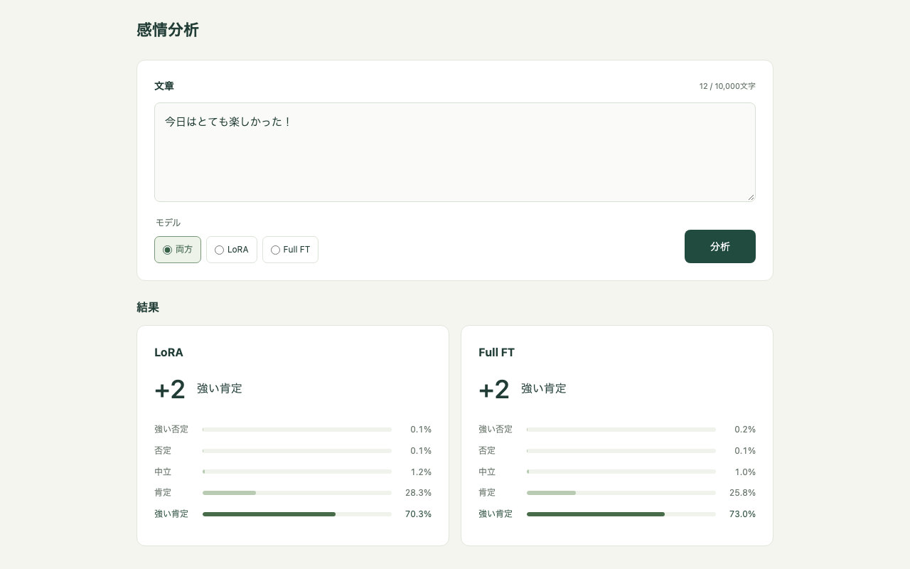
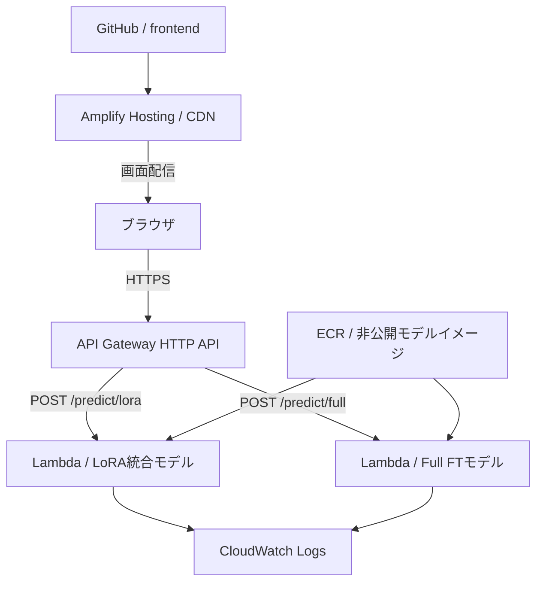

# WRIME Sentiment Demo

WRIME Ver.2で追加学習したGemma 3 270Mを使い、日本語SNS投稿を5段階の感情極性に分類する研究用Webアプリ。
LoRAとフルファインチューニング（Full FT）の予測を画面から比較する。



## 現在できること

- React + Viteの画面から、LoRA・Full FTの実モデルをローカルCPUで呼び出す。
- AWS公式 **AWS Emulator** でCloudFormation、ECR、Lambda、API Gateway等の作成・読み取り・削除を検証する。
- Lambdaコンテナ用のDockerfileを用意し、本番とローカルで推論ハンドラーを共有する。
- AWS本番環境には未デプロイ。モデル・資格情報はこの公開リポジトリに含めない。

**AWS Emulator単体でこの構成を完全再現できるわけではない。**
検証版1.0.343ではコンテナLambdaの実行が未対応で、AmplifyのCloudFormation経由の作成にも不足がある。
そのため、実モデル推論はローカルPython、画面配信はVite、AWS APIの検証はEmulatorで行う。
AWS公式Emulatorの構成では、ローカル画面のリクエストはEmulatorのAPI Gatewayを経由しない。
[検証結果と制限](docs/local-validation.md)を参照。

## FlociでAPI GatewayとLambdaまで通す

別のエミュレーター **Floci 2.4.0** では、以下の経路を実モデルで確認できた。

```text
ブラウザ → Viteのプロキシ → FlociのHTTP API → コンテナLambda → LoRA / Full FT
```

ローカルPython API（ポート8000）を停止した状態でも、ブラウザテスト2件が成功。
Lambda Invokeでも両モデルが実行できる。Amplify/CDNはFlociでも未対応のため、画面配信はViteを使う。
[比較結果](docs/emulator-comparison.md) / [HTTP APIの実測結果](docs/floci-report.json)。

モデル準備と `make setup` を済ませてから実行する。

```bash
# モデル入りLambdaイメージをビルド（既に両イメージがあれば不要）
make floci-images
# Flociを起動し、CloudFormationでAPI・Lambda等を作り、実推論を検証
make floci-up
# 画面を起動（通常の make frontend とはどちらか片方だけ）
make frontend-floci
```

<http://127.0.0.1:5173> から分析する。`make api` は不要。
`make floci-check` でLambda直接呼び出し・HTTP API経由の推論を再確認できる。
CloudFormationは本番と同じ `infra/app.yaml` を使い、Flociでは `EnableHosting=false` を渡す。
未対応リソースを成功扱いにする設定は無効化している。

ECRリポジトリは作成するが、大きなモデルイメージのpush/pullは省略し、Flociが認めるローカルDockerイメージの再利用を使う。
レジストリへ実際にモデルを転送する経路は、この検証には含めない。
FlociはDockerソケットを使い、名前空間 `wrime-sentiment` で子コンテナを起動する。
SDK接続は `127.0.0.1:4566` とダミー資格情報に固定し、AWS本番のプロファイルは使わない。

終了時は画面のターミナルでCtrl+Cし、以下を実行する。

```bash
make floci-down
```

Lambda子コンテナ・ECRのレジストリ・Flociの停止を確認済み。ビルド済みイメージとモデルはローカルに残る。
停止後の再作成ではAPI IDが変わるため、`make frontend-floci` も起動し直す。

## AWS構成



東京リージョン、CPU・FP32、1関数1モデル、初期メモリ4GBを想定。
`infra/registry.yaml` と `infra/app.yaml` のCloudFormationで管理する。
Dockerイメージのビルド・pushはCloudFormationとは別に実行する。
Amplifyは静的ホスティング用のアプリを定義しており、GitHub接続とブランチの設定は本番公開時に追加する。
APIは認証方式未実装なので、現段階では本番公開しない。CORSは認証の代わりにならない。

## ローカル起動

前提: Python 3.12、[uv](https://docs.astral.sh/uv/)、Node.js 22.12以降、Docker Compose。
Apple Siliconではarm64で実行できる。Dockerが停止している場合はDocker DesktopやColimaを先に起動する。

```bash
make setup
```

macOSでXcodeライセンス未同意のエラーになる場合、インストール済みのCommand Line Toolsを使って
`DEVELOPER_DIR=/Library/Developer/CommandLineTools make setup` のように実行できる。
他の `make` コマンドも同じ。システム全体のXcode設定を変える必要はない。

### 1. 学習済みモデルを準備

以下を別途ローカルに用意する。

- 卒論リポジトリの `thesis/experiments/full_finetuning/models/best_model`
- 同 `thesis/experiments/lora/models/best_adapter`
- 元の `google/gemma-3-270m` のローカルスナップショット（重みと設定を含む）

```bash
.venv/bin/python scripts/prepare_models.py \
  --thesis-root /path/to/sentimental \
  --base-model /path/to/local/gemma-3-270m-snapshot
```

`models/lora` にLoRA統合モデル、`models/full` にFull FTを作る。
LoRA統合前後のlogitsを比較してから保存する。自動ダウンロードや再学習は行わない。
既存出力は上書きしない。作り直す場合は `--output` で新しい出力先を選び、
API起動時に `WRIME_MODEL_ROOT` でその場所を指定する。
モデルの保存に約2.1GB、実行用メモリには別途余裕が必要。

### 2. AWS Emulatorでリソースを確認

```bash
make emulator-up
make emulator-check
```

Dockerfileは公式Linuxパッケージの1.0.343を固定し、CPUアーキテクチャに応じて選択する。
資格情報・CAは `.local/emulator/9297` に生成される。テレメトリーは無効。
`scripts/emulator.py` はlocalhostとEmulatorの資格情報だけを使い、実AWSのプロファイルを使わない。

この手順でECRに登録する空イメージは、作成API確認用のメタデータのみ。
Lambdaへモデルを配置したことや、Emulator内で推論できたことを意味しない。
結果は `.local/emulator-report.json` に出力する。再実行は `make emulator-check`、
再作成は一度 `make emulator-down` してから行う。

### 3. 実モデルのAPIと画面を起動

ターミナルを2つ使う。

```bash
# ターミナル1: http://127.0.0.1:8000
make api
```

```bash
# ターミナル2: http://127.0.0.1:5173
make frontend
```

ブラウザで <http://127.0.0.1:5173> を開く。
Viteのプロキシが `/predict/*` をローカルAPIへ転送し、同じLambdaハンドラーで推論する。
両モデルの比較、クラス別確率、切り詰め表示、APIエラーに対応。
初回はモデルの読み込み時間がかかる。入力文章はアプリのログに保存しない。

## API

`POST /predict/lora` または `POST /predict/full`

```bash
curl http://127.0.0.1:8000/predict/lora \
  -H 'Content-Type: application/json' \
  -d '{"text":"今日はとても楽しかった！"}'
```

```json
{
  "model": "lora",
  "model_version": "7d55d679e1c3",
  "sentiment": 2,
  "probabilities": {"-2": 0.01, "-1": 0.02, "0": 0.07, "1": 0.25, "2": 0.65},
  "truncated": false,
  "elapsed_ms": 30.0
}
```

数値は説明用。感情極性は `-2, -1, 0, +1, +2`。
5個のスコアにsoftmaxを適用し、最大値のクラスを返す。確率は正答率を保証するものではない。
空入力・10,000文字超過は400、64KiB超の本文は413、モデル未準備は503。
入力は特殊トークン込み512トークンに切り詰め、発生時は `truncated: true` を返す。

## 検証

```bash
make test
# API起動後、実モデルで8件の推論と不正入力を確認
make smoke
# API起動後、実モデルのブラウザE2E
cd frontend
npx playwright install chromium
npm run test:e2e
```

[2026-11-13の検証結果](docs/local-validation.md) / [モバイル画面](docs/mobile.png)

## Lambdaコンテナのローカル確認

AWS EmulatorはコンテナLambdaを実行しないため、Lambdaベースイメージに含まれる
Runtime Interface Emulator（RIE）で別途確認できる。

```bash
docker build --platform linux/arm64 --provenance=false \
  --build-arg MODEL_METHOD=lora -f backend/Dockerfile -t wrime-lora:local .
docker run --rm --memory=4g --read-only --tmpfs /tmp \
  -p 127.0.0.1:9001:8080 wrime-lora:local
```

別ターミナルからAPI Gateway形式のイベントを渡す。

```bash
curl http://127.0.0.1:9001/2015-03-31/functions/function/invocations \
  -H 'Content-Type: application/json' \
  -d '{"version":"2.0","body":"{\"text\":\"今日は楽しかった！\"}","isBase64Encoded":false}'
```

Full FTは `MODEL_METHOD=full` とタグを変えてビルドする。実AWSのarm64関数にも同じ形式のイメージを使う。
RIEで動いても、AWSのIAM、ネットワーク、初期化時間、API Gatewayとの統合は別途検証が必要。

## 本番へ進む前に

- モデルを含む実イメージを非公開ECRへpushし、URIまたはdigestをCloudFormationへ渡す。
- AmplifyのGitHub接続・公開ブランチを設定し、`VITE_API_BASE_URL` とCORSの公開オリジンを合わせる。
- API認証と利用制限を決める。フロントにAWSアクセスキーや秘密情報を埋め込まない。
- HTTP APIの最大30秒を、Lambdaのコールドスタート込みで検証する。
- エミュレーターではIAMの実際の許可・拒否を保証できないため、実AWSでも確認する。

## 終了と費用

この作業は短期間の動作確認を目的とし、無料枠・クレジットによる0円は保証しない。
ローカル実行では実AWSリソースを作らない。

```bash
# API・フロントは各ターミナルでCtrl+C
make emulator-down
```

Emulatorの状態は停止で消える。モデルとDockerイメージはローカルに残る。
`make emulator-down` が失敗しても `docker compose down` でEmulatorを停止すれば状態は消える。
実AWSへ公開した場合はスタックに加え、Amplify、ECRイメージ、ログ、デプロイ用S3などの残存も確認する。
CloudFormationの `DeletionPolicy` に注意し、ブラウザを閉じるだけで終了扱いにしない。

## ディレクトリ

```text
frontend/   React + Vite・ブラウザテスト
backend/    共通推論・Lambdaハンドラー・ローカルHTTPアダプター・Dockerfile
infra/      CloudFormation YAML（レジストリ・アプリ）
emulator/   AWS公式EmulatorのDockerfile
scripts/    モデル準備・AWS Emulator / Floci検証・推論スモークテスト
tests/      ハンドラー・HTTP入力検証
docs/       検証結果・画面
```

## 参考

- [Floci公式リポジトリ](https://github.com/floci-io/floci)
- [AWS Emulator公式リポジトリ](https://github.com/aws/aws-emulator)
- [AWS EmulatorのDocker起動](https://docs.aws.amazon.com/emulator/latest/userguide/getting-started-docker.html)
- [AWS Emulatorの制限](https://docs.aws.amazon.com/emulator/latest/userguide/what-is-service.html)
- [Lambdaコンテナのローカルテスト](https://docs.aws.amazon.com/lambda/latest/dg/python-image.html)
- [HTTP APIの制限](https://docs.aws.amazon.com/apigateway/latest/developerguide/http-api-quotas.html)
